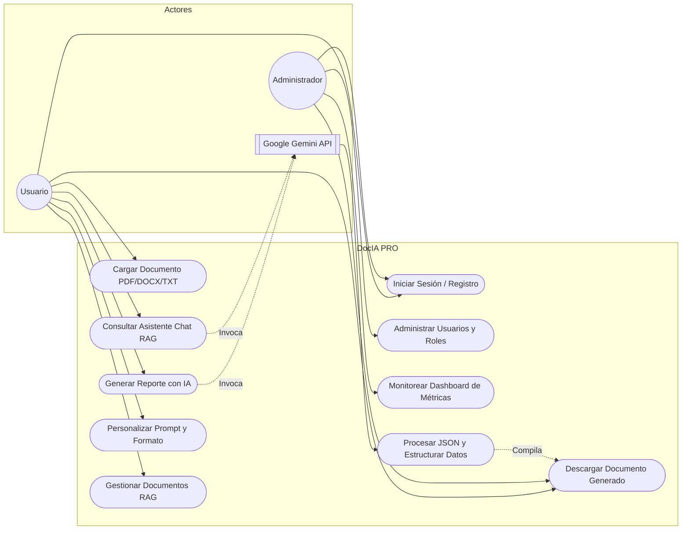
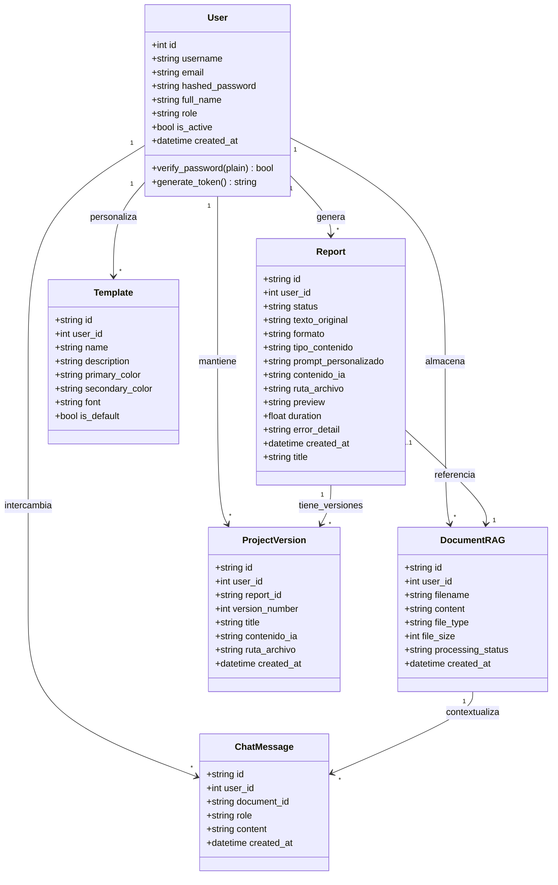
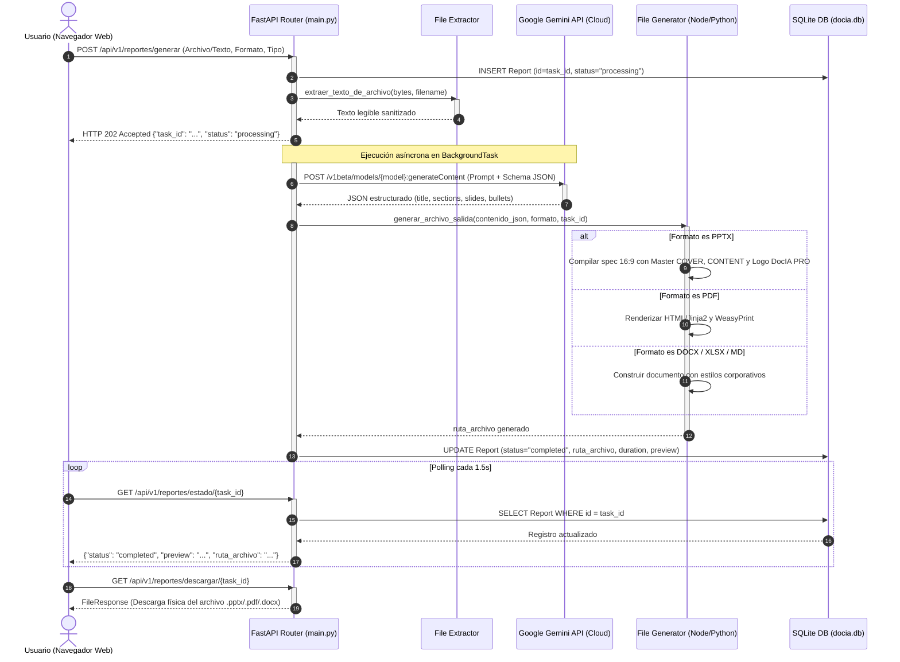
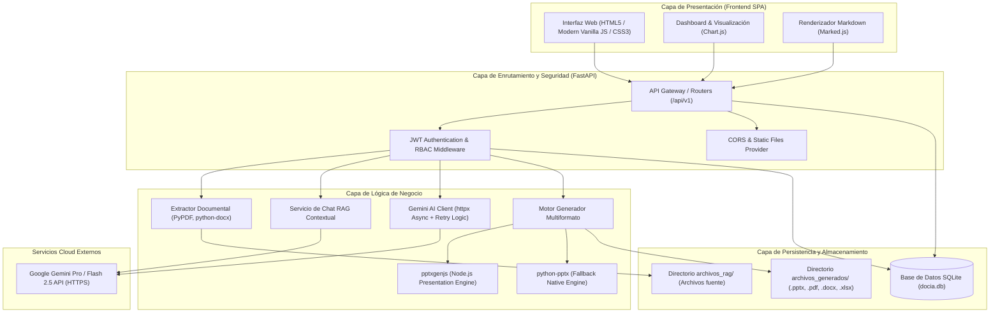

# DocIA PRO · Documento de Requerimientos del Sistema y Arquitectura de Software

**Proyecto:** DocIA PRO – Sistema Inteligente de Análisis Documental y Generación Ejecutiva Multiformato  
**Materia / Curso:** Análisis de Sistemas II (8vo Semestre)  
**Versión:** 2.0 (DocIA PRO Edition)  
**Fecha:** Octubre 2026  
**Estado:** Prototipo Funcional en Producción (Docker)

---

## 1. Introducción y Alcance del Sistema

### 1.1 Propósito
DocIA PRO es una plataforma empresarial orientada a la transformación digital y automatización del procesamiento documental corporativo y académico. Integra tecnologías avanzadas de Procesamiento de Lenguaje Natural (PLN) y Retrieval-Augmented Generation (RAG) mediante modelos fundacionales de Inteligencia Artificial (Google Gemini), permitiendo la ingesta de documentos heterogéneos (PDF, DOCX, TXT) y su síntesis estructurada en múltiples formatos de salida ejecutiva (PDF, DOCX, PPTX 16:9 corporativo, Excel XLSX, Markdown, Texto plano y HTML).

### 1.2 Alcance
El sistema cubre:
- Autenticación y control de acceso seguro basado en roles (Usuario estándar y Administrador).
- Extracción de texto y preprocesamiento de documentos complejos.
- Gestor documental RAG para enriquecimiento de contexto semántico.
- Asistente de chat interactivo contextual con memoria histórica por documento.
- Motor de estructuración mediante IA que fuerza esquemas JSON validados.
- Generador multiformato con diseño ejecutivo de alta fidelidad estética (incluyendo presentaciones panorámicas 16:9 con branding oficial DocIA PRO).
- Persistencia relacional de reportes, historiales, versiones y métricas analíticas.
- Monitoreo en tiempo real del estado de salud del motor IA y consumo de recursos.

---

## 2. Requerimientos Funcionales (RF)

| ID | Requerimiento | Descripción | Prioridad |
|---|---|---|---|
| **RF-01** | **Autenticación y Registro de Usuarios** | El sistema debe permitir a los usuarios registrarse e iniciar sesión mediante credenciales seguras, retornando un token de sesión JWT cifrado con bcrypt. | Alta |
| **RF-02** | **Carga y Extracción de Documentos** | El sistema debe recibir archivos en formatos `.pdf`, `.docx` y `.txt`, validar su tamaño y tipo MIME, y extraer su contenido textual íntegro sin pérdida de coherencia. | Alta |
| **RF-03** | **Gestor de Documentos RAG** | El usuario podrá almacenar documentos en una base de conocimiento contextual (RAG) para vincularlos en consultas analíticas y generación de reportes especializados. | Alta |
| **RF-04** | **Generación de Reportes con IA** | El sistema debe procesar el texto seleccionado o suministrado mediante la API de Google Gemini, generando reportes en 5 tipos: Reporte Maestro, Resumen Ejecutivo, Presentación, Cuestionario (Q&A) y Puntos Clave. | Alta |
| **RF-05** | **Instrucción Personalizada (Prompt)** | El usuario podrá introducir instrucciones personalizadas o directrices específicas que guiarán el enfoque del análisis generado por la IA. | Media |
| **RF-06** | **Exportación Multiformato de Alta Fidelidad** | El sistema debe exportar los resultados a 7 formatos: PDF (WeasyPrint con encabezados y numeración), DOCX (Word corporativo), PPTX (PowerPoint 16:9 con temas y logotipo oficial), XLSX (Excel con hojas organizadas), MD, TXT y HTML. | Alta |
| **RF-07** | **Chat Contextual con IA (Q&A)** | Interfaz de mensajería interactiva donde el usuario puede interrogar a la IA respecto a un documento específico de la base RAG o mantener una conversación analítica general. | Alta |
| **RF-08** | **Persistencia de Historial e Interacciones** | Registro persistente de cada reporte generado, tiempo de ejecución, resumen previo, parámetros de configuración, chats y documentos cargados. | Alta |
| **RF-09** | **Dashboard de Métricas y Analítica** | Visualización en tiempo real del total de reportes procesados, tiempo promedio de generación, distribución por formato, consumo de tokens y estado del sistema. | Media |
| **RF-10** | **Generación Directa de Presentaciones API** | Endpoint REST dedicado (`/api/presentations`) que recibe especificaciones JSON estructuradas de diapositivas (título, portada, viñetas, notas) y compila un archivo PPTX panorámico listo para descarga. | Alta |
| **RF-11** | **Control de Acceso y Roles (Admin/User)** | Panel de administración para gestión de usuarios, revocación de accesos y auditoría de documentos y reportes del sistema. | Media |
| **RF-12** | **Gestor de Versiones y Borradores** | Capacidad de crear borradores de trabajo y versionar reportes existentes sin sobreescribir el original. | Baja |

---

## 3. Requerimientos No Funcionales (RNF)

| ID | Categoría | Requerimiento No Funcional | Criterio de Medición |
|---|---|---|---|
| **RNF-01** | **Ciberseguridad** | Las claves de API (`GEMINI_API_KEY`) y secretos de sesión deben inyectarse exclusivamente por variables de entorno del sistema (`.env`), quedando estrictamente prohibido su almacenamiento en código fuente o repositorios Git. | Cero credenciales expuestas en Git/código |
| **RNF-02** | **Seguridad de Datos** | Las contraseñas de usuario deben cifrarse irreversiblemente utilizando el algoritmo `bcrypt` con salting automático. | Almacenamiento seguro en BD SQLite |
| **RNF-03** | **Sanitización de Entradas** | Toda entrada del usuario y contenido extraído debe sanitizarse eliminando caracteres de control ASCII nulos o invisibles que puedan generar fallos o inyecciones en bibliotecas como OpenPyXL o motores PDF. | Prevención de errores tipo IllegalCharacterError |
| **RNF-04** | **Resiliencia de Red** | Las peticiones a la API de Inteligencia Artificial deben contar con timeouts configurados (90s) y una política de reintentos exponenciales automáticos ante errores transitorios (HTTP 429, 500, 502, 503, 504). | 3 reintentos con backoff exponencial |
| **RNF-05** | **Rendimiento y Asincronía** | Las tareas pesadas de generación documental deben procesarse en segundo plano (`BackgroundTasks`) permitiendo que la API responda inmediatamente un ID de seguimiento con polling de estado. | Tiempo de respuesta HTTP inicial < 500 ms |
| **RNF-06** | **Disponibilidad** | El sistema debe ejecutarse en contenedores Docker autónomos con reinicio automático (`restart: unless-stopped`) y verificación periódica de salud (`/health`). | Uptime continuo del contenedor |
| **RNF-07** | **Portabilidad y Contenerización** | Toda la solución debe ser desplegable en cualquier entorno Windows/Linux mediante `docker compose`, manteniendo volúmenes persistentes para la base de datos y los archivos generados. | Ejecución reproducible multiplataforma |
| **RNF-08** | **Estructuración Estricta** | El motor de IA debe configurarse en modo de respuesta estructurada forzada (`responseMimeType: "application/json"` con `responseSchema` validado) evitando fallos de parseo sintáctico. | Validación estricta con Pydantic / JSON |
| **RNF-09** | **Estética y Branding** | Cada documento e interfaz generada debe adherirse a la identidad corporativa oficial DocIA PRO, incluyendo paleta de colores (`#1F3A5F`, `#F2A541`), tipografías ejecutivas y el logotipo 3D en alta definición. | Cumplimiento del manual de estilo |
| **RNF-10** | **Usabilidad** | La interfaz SPA (Single Page Application) debe ser responsive (adaptada a pantallas móviles y de escritorio) con tiempos de carga optimizados y retroalimentación interactiva durante el procesamiento. | Experiencia de usuario fluida |

---

## 4. Diagramas UML del Sistema

### 4.1 Diagrama de Casos de Uso
Representa las interacciones principales entre los usuarios del sistema, el administrador y el servicio de IA externo:



---

### 4.2 Diagrama de Clases (Dominio de Datos y Persistencia)
Estructura relacional mapeada con SQLAlchemy ORM sobre la base de datos `docia.db`:



---

### 4.3 Diagrama de Secuencia (Flujo Completo de Generación de Reportes)
Secuencia temporal desde la solicitud del cliente web hasta la entrega del archivo físico procesado por IA:



---

### 4.4 Diagrama de Arquitectura y Componentes
Arquitectura multicapa modular desacoplada desplegada bajo Docker:



---

## 5. Integración Real con la API de Inteligencia Artificial

### 5.1 Proveedor y Modelo Seleccionado
- **Proveedor:** Google AI Cloud (Google Generative AI).
- **Endpoint:** `https://generativelanguage.googleapis.com/v1beta/models/{model}:generateContent`
- **Modelo por defecto:** `gemini-2.5-flash` (configurable dinámicamente vía `.env` a `gemini-1.5-flash` o `gemini-3.1-flash-lite`).
- **Autenticación:** Mediante cabecera HTTP `x-goog-api-key: ${GEMINI_API_KEY}`.

### 5.2 Estructuración Forzada (JSON Schema Enforcement)
Para eliminar alucinaciones sintácticas y garantizar que los exportadores (especialmente PowerPoint y Excel) reciban datos predecibles, la petición fuerza un esquema estricto:

```json
{
  "type": "OBJECT",
  "properties": {
    "title": {"type": "STRING"},
    "subtitle": {"type": "STRING"},
    "summary": {"type": "STRING"},
    "sections": {
      "type": "ARRAY",
      "items": {
        "type": "OBJECT",
        "properties": {
          "title": {"type": "STRING"},
          "paragraphs": {"type": "ARRAY", "items": {"type": "STRING"}},
          "bullets": {"type": "ARRAY", "items": {"type": "STRING"}}
        },
        "required": ["title", "paragraphs", "bullets"]
      }
    },
    "slides": {
      "type": "ARRAY",
      "items": {
        "type": "OBJECT",
        "properties": {
          "title": {"type": "STRING"},
          "bullets": {"type": "ARRAY", "items": {"type": "STRING"}}
        },
        "required": ["title", "bullets"]
      }
    },
    "qa": {
      "type": "ARRAY",
      "items": {
        "type": "OBJECT",
        "properties": {
          "question": {"type": "STRING"},
          "answer": {"type": "STRING"}
        },
        "required": ["question", "answer"]
      }
    },
    "key_points": {"type": "ARRAY", "items": {"type": "STRING"}}
  },
  "required": ["title", "subtitle", "summary", "sections", "slides", "qa", "key_points"]
}
```

---

## 6. Prototipo Funcional (Flujo Extremo a Extremo)

El sistema demuestra un flujo completamente operativo y probado:
1. **Entrada:** El usuario ingresa a <http://localhost:8000>, selecciona o arrastra un archivo `.pdf`, `.docx` o `.txt` (o pega texto directamente), escoge el tipo de análisis (Reporte Maestro, Resumen Ejecutivo, Presentación, Q&A, Puntos Clave) y el formato deseado (`pptx`, `pdf`, `docx`, `xlsx`, `md`, `txt`, `html`).
2. **Procesamiento Inteligente:**
   - FastAPI recibe la carga, valida la firma del archivo y extrae el texto puro.
   - Envía el contexto y la instrucción a Gemini API mediante un cliente asíncrono no bloqueante (`httpx.AsyncClient`).
   - Gemini analiza el documento y produce un JSON enriquecido de alta fidelidad.
3. **Salida y Generación Multiformato:**
   - Si se solicitó **PPTX**, el motor compila diapositivas panorámicas 16:9 con portada corporativa, barra superior de acento, viñetas estilizadas y el logotipo oficial de DocIA PRO.
   - Si se solicitó **PDF**, WeasyPrint renderiza una maqueta paginada A4 con tipografía ejecutiva, marcas de agua y numeración.
   - Si se solicitó **XLSX**, OpenPyXL estructura hojas de trabajo con títulos, formato de celdas automático y autofiltros.
4. **Descarga y Consulta:** El usuario previsualiza el resultado en pantalla mediante Markdown parseado y descarga el binario con un solo clic.

---

## 7. Persistencia de Datos

El sistema implementa persistencia en dos niveles fundamentales:
1. **Persistencia Relacional (SQLite + SQLAlchemy):**
   - Archivo: `docia.db`.
   - **`users`:** Cuentas registradas, hashes de contraseñas, roles y timestamps.
   - **`reports`:** Registro completo de tareas, estado (`processing`, `completed`, `error`), texto de origen, formato, prompt personalizado, contenido JSON generado, ruta del archivo en disco y duración en segundos.
   - **`documents_rag`:** Metadatos de archivos subidos a la base de conocimiento y su texto procesado.
   - **`chat_messages`:** Historial de conversaciones interactivas vinculadas a cada usuario y documento.
2. **Almacenamiento Físico en Disco:**
   - `/app/archivos_generados/`: Almacén de los archivos físicos binarios creados para su posterior descarga.
   - `/app/archivos_rag/`: Documentos crudos cargados como fuentes de contexto.
   - Ambos directorios están mapeados a volúmenes Docker en el host para garantizar persistencia tras reinicios del contenedor.

---

## 8. Manejo de Errores y Resiliencia en Llamadas a la API

El archivo `services/gemini_service.py` cuenta con mecanismos de defensa ante contingencias:
1. **Límites de Tiempo (Timeouts):** Timeout total de 90 segundos con 10 segundos de establecimiento de conexión para evitar bloqueos por latencia de red.
2. **Reintentos Exponenciales (Exponential Backoff):** Ante códigos de estado HTTP transitorios (429 por límite de cuota/rate limit, 500, 502, 503, 504 por saturación del proveedor), el sistema reintenta automáticamente hasta 3 veces aplicando una pausa incremental:
   $$\text{Espera} = 0.5 \times 2^{\text{intento}} \text{ segundos}$$
3. **Control de Agotamiento de Tokens (`MAX_TOKENS`):** Si Gemini devuelve `finishReason == "MAX_TOKENS"`, el sistema intercepta la condición e informa al usuario de manera comprensible que el documento debe modularse.
4. **Filtros de Seguridad de IA:** Captura de excepciones cuando la respuesta es bloqueada por los filtros de seguridad de Google AI Studio, impidiendo la caída del servidor.
5. **Validación Sintáctica:** Si la respuesta de la IA no es un JSON válido o incumple la estructura de campos requerida, se produce un error controlado y se actualiza el estado de la tarea a `"error"` con descripción detallada en la base de datos.

---

## 9. Evidencia de Pruebas del Sistema

Matriz de casos de prueba ejecutados y verificados:

| Caso | Tipo de Entrada | Datos Suministrados | Resultado Esperado | Resultado Obtenido | Estado |
|---|---|---|---|---|:---:|
| **CP-01** | Entrada Válida | Documento PDF empresarial de 15 páginas + solicitud PPTX | Generación de presentación 16:9 con portada, viñetas y logo DocIA PRO | Archivo PPTX de 515 KB generado y descargado | **Éxito** |
| **CP-02** | Entrada Válida | Texto plano copiado (1,500 palabras) + formato PDF | Reporte paginado en PDF con estilos ejecutivos y pie de página | Archivo PDF generado con WeasyPrint en 4.2s | **Éxito** |
| **CP-03** | Entrada Válida | Petición API directa `POST /api/presentations` con JSON válido | Descarga directa de archivo `.pptx` estructurado | HTTP 200 con binary stream de presentación | **Éxito** |
| **CP-04** | Entrada Válida | Interacción con Chat RAG seleccionando documento | Respuesta analítica contextual con avatar oficial de DocIA PRO | Mensaje Markdown instantáneo con citas del texto | **Éxito** |
| **CP-05** | Entrada Inválida | Archivo con extensión no permitida (`.exe`, `.bin`, `.py`) | Rechazo HTTP 400 indicando formatos permitidos (.pdf, .docx, .txt) | HTTP 400 Bad Request con mensaje descriptivo | **Éxito** |
| **CP-06** | Entrada Inválida | Archivo de 0 bytes o contenido textual completamente vacío | Detección temprana y mensaje "No se pudo extraer texto legible" | HTTP 400 con bloqueo antes de invocar la IA | **Éxito** |
| **CP-07** | Entrada Inválida | Petición JSON a `/api/presentations` sin arreglo de diapositivas (`slides: []`) | Rechazo de la petición por esquema incompleto | HTTP 400: "Se requiere un arreglo 'slides' no vacío" | **Éxito** |
| **CP-08** | Entrada Inválida | Documento con caracteres ASCII nulos/ilegales (\x00, \x08) | Sanitización preventiva mediante regex antes de OpenPyXL | Exportación a XLSX limpia sin fallo IllegalCharacterError | **Éxito** |
| **CP-09** | Caso de Borde | Petición sin token de autenticación a rutas protegidas (`/api/v1/chat/message`) | Rechazo de acceso por falta de credenciales | HTTP 401 Unauthorized / Token inválido | **Éxito** |
| **CP-10** | Caso de Borde | Generación con clave `GEMINI_API_KEY` ausente o no configurada | Manejo de excepción controlada sin caída del servidor Uvicorn | Error descriptivo "Falta configurar GEMINI_API_KEY" | **Éxito** |

---

## 10. Ciberseguridad y Protección de Datos

En cumplimiento de las buenas prácticas de la industria y los estándares del curso:
1. **Gestión de Secretos con Variables de Entorno (`.env`):**
   - La API Key de Gemini y los secretos de cifrado residen en el archivo `.env`.
   - `.env` está expresamente excluido de control de versiones mediante `.gitignore` y de las imágenes Docker mediante `.dockerignore`.
   - Ninguna credencial privada existe en el código fuente.
2. **Validación y Sanitización Estricta de Entradas:**
   - Lista blanca de extensiones permitidas (`.pdf`, `.docx`, `.txt`) y tipos MIME.
   - Filtro de expresiones regulares para caracteres de control ASCII que previene inyecciones en bibliotecas de ofimática.
   - Pydantic valida tipos y longitudes de todas las peticiones JSON entrantes.
3. **Cifrado de Credenciales y Sesiones JWT:**
   - Contraseñas almacenadas en SQLite cifradas con `bcrypt` con hash irreversible.
   - Tokens de autenticación basados en estándares seguros con tiempo de expiración definido.
4. **Aislamiento en Contenedor (Docker Sandbox):**
   - Ejecución bajo contenedor Linux con privilegios limitados, protegiendo el sistema operativo host.
   - Montajes de volúmenes restringidos únicamente a los directorios requeridos (`docia.db`, `archivos_generados/`, `archivos_rag/`).
5. **Mitigación de Fuga de Datos (Prompt Injection & Loop Rule):**
   - Directriz de sistema `STRICT_ANTI_LOOP_RULE` inyectada en cada prompt a Gemini, restringiendo la salida a hechos presentes en el documento e impidiendo manipulaciones o fugas de contexto fuera del documento fuente.

---

*DocIA PRO · Sistema de Inteligencia Documental Avanzada*  
*Desarrollado para la materia Análisis de Sistemas II · Octubre 2026*
